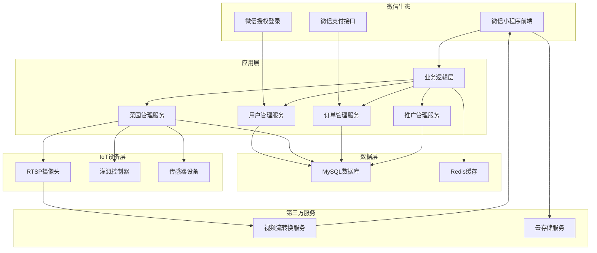

# 设计文档

## 概述

智慧共享菜园微信小程序是一个基于微信生态的IoT农业管理平台，定位为快速落地的工程原型版，聚焦"共享菜园"核心场景。系统面向C端普通用户（想拥有菜园）和B端用地用户（有餐厅/菜园用地），实现菜园远程可视化监控、灌溉设备远程控制、农事服务预约、推广裂变四大核心能力。

### 核心价值主张
- **对C端用户**: 足不出户查看菜园状态、远程管控灌溉、便捷预约农事服务
- **对B端用户**: 快速入驻共享菜园生态，盘活闲置菜园/餐厅用地资源  
- **对平台**: 通过推广码实现用户裂变，沉淀首批种子用户与用地资源

### 设计原则
1. **快速落地**: 优先保障功能可用性，简化非核心交互与复杂逻辑
2. **极简设计**: 核心功能操作步骤≤3步，减少动画效果，突出核心按钮
3. **微信生态**: 深度集成微信小程序能力，仅支持微信授权登录
4. **原型验证**: 为后续商业化迭代提供验证基础，预留扩展接口

## 架构

### 整体架构



### 技术栈选择

**前端技术栈:**
- 微信小程序原生框架 (WXML/WXSS/JavaScript) - 优先原生，降低复杂度
- 微信小程序基础组件库 - 减少第三方组件依赖
- live-player组件用于视频播放 - 支持RTSP协议转换
- 微信云存储用于静态资源 - 推广码、截图等资源存储

**后端技术栈:**
- Node.js + Express.js 轻量级框架 - 快速开发，易于部署
- MySQL 8.0 关系型数据库 - 简易表结构，满足原型需求
- Redis 6.0 缓存和会话管理 - 提升响应性能
- JWT 用户认证 - 无状态认证机制
- HTTPS/WSS 安全通信 - 保障数据传输安全

**IoT集成:**
- RTSP到HLS/RTMP转换服务 - 摄像头画面适配小程序
- HTTP/HTTPS API用于设备控制 - 灌溉设备远程控制
- WebSocket用于实时状态同步 - 设备状态实时更新

**部署要求:**
- 云服务器（2核4G配置） - 支持小程序域名备案
- 支持≤100人并发访问 - 原型版性能要求
- 预留阿里云IoT/腾讯连连平台接口 - 后续设备接入扩展

## 组件和接口

### 前端组件架构

```mermaid
graph TD
    A[App.js 应用入口] --> B[页面层 Pages]
    A --> C[组件层 Components]
    A --> D[服务层 Services]
    A --> E[工具层 Utils]
    
    B --> B1[登录页 Login]
    B --> B2[首页 Home]
    B --> B3[菜园监控 Monitor]
    B --> B4[服务列表 Services]
    B --> B5[订单管理 Orders]
    B --> B6[个人中心 Profile]
    B --> B7[推广中心 Promotion]
    
    C --> C1[视频播放器 VideoPlayer]
    C --> C2[控制面板 ControlPanel]
    C --> C3[服务卡片 ServiceCard]
    C --> C4[订单卡片 OrderCard]
    C --> C5[推广码 QRCode]
    
    D --> D1[用户服务 UserService]
    D --> D2[菜园服务 GardenService]
    D --> D3[订单服务 OrderService]
    D --> D4[推广服务 PromotionService]
    
    E --> E1[网络请求 Request]
    E --> E2[存储管理 Storage]
    E --> E3[工具函数 Helpers]
```



### 后端服务架构

```mermaid
graph TD
    A[Express App] --> B[路由层 Routes]
    A --> C[中间件层 Middleware]
    A --> D[控制器层 Controllers]
    A --> E[服务层 Services]
    A --> F[数据访问层 DAL]
    
    B --> B1[用户路由 /api/users]
    B --> B2[菜园路由 /api/gardens]
    B --> B3[订单路由 /api/orders]
    B --> B4[推广路由 /api/promotions]
    B --> B5[设备路由 /api/devices]
    
    C --> C1[认证中间件 Auth]
    C --> C2[日志中间件 Logger]
    C --> C3[错误处理 ErrorHandler]
    C --> C4[限流中间件 RateLimit]
    
    D --> D1[用户控制器 UserController]
    D --> D2[菜园控制器 GardenController]
    D --> D3[订单控制器 OrderController]
    D --> D4[推广控制器 PromotionController]
    D --> D5[设备控制器 DeviceController]
    
    E --> E1[用户服务 UserService]
    E --> E2[菜园服务 GardenService]
    E --> E3[订单服务 OrderService]
    E --> E4[推广服务 PromotionService]
    E --> E5[设备服务 DeviceService]
    
    F --> F1[用户数据访问 UserDAO]
    F --> F2[菜园数据访问 GardenDAO]
    F --> F3[订单数据访问 OrderDAO]
    F --> F4[推广数据访问 PromotionDAO]
```



### 核心接口定义

**用户认证接口:**
```javascript
// 微信登录（免注册，仅获取公开信息）
POST /api/auth/wechat-login
Request: { 
  code: string,           // 微信授权码
  encryptedData: string,  // 加密用户信息（可选）
  iv: string             // 初始向量（可选）
}
Response: { 
  token: string,         // JWT令牌
  userInfo: {
    id: string,          // 自动生成用户ID
    nickname: string,    // 微信昵称
    avatarUrl: string,   // 微信头像
    promotionCode: string // 自动生成推广码
  },
  isFirstLogin: boolean  // 是否首次登录
}

// 获取用户信息
GET /api/users/profile
Headers: { Authorization: "Bearer <token>" }
Response: { 
  user: {
    id: string,
    nickname: string,
    avatarUrl: string,
    promotionCode: string,
    gardenCount: number,   // 绑定菜园数量
    orderCount: number,    // 订单总数
    createdAt: string
  },
  gardens: Garden[],       // 已绑定菜园列表
  recentOrders: Order[]    // 最近订单
}
```

**菜园管理接口:**
```javascript
// 绑定菜园（手动输入菜园ID）
POST /api/gardens/bind
Request: { gardenId: string }
Response: { 
  success: boolean, 
  garden: {
    id: string,
    name: string,
    location: string,
    area: number,
    bindTime: string,
    status: "active" | "inactive" | "maintenance"
  }
}

// 解绑菜园（清空相关权限）
DELETE /api/gardens/:id/unbind
Response: { 
  success: boolean, 
  message: string 
}

// 获取菜园列表（用户已绑定）
GET /api/gardens/list
Response: { 
  gardens: Garden[],
  totalCount: number
}

// 获取实时视频流（RTSP转换）
GET /api/gardens/:id/stream
Response: { 
  streamUrl: string,     // HLS/RTMP播放地址
  protocol: "HLS" | "RTMP",
  resolution: "720P",    // 最低720P要求
  maxDelay: 3           // 最大延迟3秒
}
```

**设备控制接口:**
```javascript
// 灌溉控制（支持时长选择）
POST /api/devices/irrigation/control
Request: { 
  gardenId: string, 
  duration: 5 | 10 | 15, // 分钟，默认10分钟
  action: "start" | "stop" 
}
Response: { 
  success: boolean, 
  status: "idle" | "running" | "cooldown", 
  remainingTime: number,
  cooldownTime: number // 30秒冷却时间
}

// 获取设备状态
GET /api/devices/:gardenId/status
Response: { 
  irrigation: {
    status: "idle" | "running" | "error",
    remainingTime: number,
    lastOperation: string,
    cooldownRemaining: number
  },
  camera: {
    status: "online" | "offline",
    streamUrl: string, // RTSP转换后的播放地址
    resolution: "720P" | "1080P",
    delay: number // 延迟时间，要求≤3秒
  }
}

// 摄像头截图（本地保存）
POST /api/devices/camera/snapshot
Request: { gardenId: string }
Response: { 
  success: boolean, 
  snapshotUrl: string, // 临时访问地址
  savedLocal: boolean  // 原型版仅本地保存
}
```

**服务预约接口:**
```javascript
// 获取服务列表（预设5类核心服务）
GET /api/services/list
Response: { 
  services: [
    {
      id: string,
      name: "菜园认领" | "果蔬采摘" | "施肥养护" | "定制种植" | "农具租赁",
      description: string, // ≤100字极简描述
      price: number,
      serviceRange: string,
      bookingNotice: string
    }
  ]
}

// 创建订单（原型版无真实支付）
POST /api/orders/create
Request: { 
  serviceId: string, 
  appointmentDate: string, // 近7天可选
  contactName: string,
  contactPhone: string,
  remarks: string
}
Response: { 
  orderId: string, 
  orderNo: string, // 唯一订单编号
  order: Order,
  paymentStatus: "pending" // 原型版占位
}

// 获取订单列表（按状态分类）
GET /api/orders/list
Response: { 
  orders: {
    pending: Order[],    // 待确认
    confirmed: Order[],  // 已确认  
    completed: Order[],  // 已完成
    cancelled: Order[]   // 已取消
  }
}

// 取消订单（仅待确认状态）
PUT /api/orders/:id/cancel
Response: { success: boolean, order: Order }
```

**推广裂变接口:**
```javascript
// 获取用户推广码
GET /api/promotion/code
Response: { 
  promotionCode: string, // 含用户ID标识
  qrCodeUrl: string,     // 二维码图片URL
  promotionRules: string // 推广规则文案
}

// 角色选择处理
POST /api/promotion/role-select
Request: { role: "provider" | "consumer" }
Response: { redirectUrl: string }

// 入驻申请提交
POST /api/applications/submit
Request: {
  contactName: string,
  contactPhone: string,
  landArea: number,
  location: string
}
Response: { 
  applicationId: string,
  message: "提交成功，3个工作日内联系"
}

// 获取推广数据（原型版静态占位）
GET /api/promotion/stats
Response: {
  inviteCount: number,    // 邀请人数，默认0
  orderCount: number      // 推广订单数，默认0
}
```

## 数据模型

### 数据库设计

```sql
-- 用户表
CREATE TABLE users (
    id VARCHAR(36) PRIMARY KEY,
    wechat_openid VARCHAR(100) UNIQUE NOT NULL,
    nickname VARCHAR(100),
    avatar_url VARCHAR(500),
    promotion_code VARCHAR(20) UNIQUE,
    created_at TIMESTAMP DEFAULT CURRENT_TIMESTAMP,
    updated_at TIMESTAMP DEFAULT CURRENT_TIMESTAMP ON UPDATE CURRENT_TIMESTAMP
);

-- 菜园表
CREATE TABLE gardens (
    id VARCHAR(36) PRIMARY KEY,
    name VARCHAR(100) NOT NULL,
    location VARCHAR(200),
    area DECIMAL(10,2),
    description TEXT,
    camera_rtsp_url VARCHAR(500),
    irrigation_device_id VARCHAR(100),
    status ENUM('active', 'inactive', 'maintenance') DEFAULT 'active',
    created_at TIMESTAMP DEFAULT CURRENT_TIMESTAMP,
    updated_at TIMESTAMP DEFAULT CURRENT_TIMESTAMP ON UPDATE CURRENT_TIMESTAMP
);

-- 用户菜园绑定表
CREATE TABLE user_gardens (
    id VARCHAR(36) PRIMARY KEY,
    user_id VARCHAR(36) NOT NULL,
    garden_id VARCHAR(36) NOT NULL,
    bind_time TIMESTAMP DEFAULT CURRENT_TIMESTAMP,
    status ENUM('active', 'inactive') DEFAULT 'active',
    FOREIGN KEY (user_id) REFERENCES users(id),
    FOREIGN KEY (garden_id) REFERENCES gardens(id),
    UNIQUE KEY unique_user_garden (user_id, garden_id)
);

-- 服务表
CREATE TABLE services (
    id VARCHAR(36) PRIMARY KEY,
    name VARCHAR(100) NOT NULL,
    description TEXT,
    price DECIMAL(10,2),
    service_range VARCHAR(200),
    booking_notice TEXT,
    status ENUM('active', 'inactive') DEFAULT 'active',
    created_at TIMESTAMP DEFAULT CURRENT_TIMESTAMP
);

-- 订单表
CREATE TABLE orders (
    id VARCHAR(36) PRIMARY KEY,
    order_no VARCHAR(32) UNIQUE NOT NULL,
    user_id VARCHAR(36) NOT NULL,
    service_id VARCHAR(36) NOT NULL,
    appointment_date DATE,
    contact_name VARCHAR(50),
    contact_phone VARCHAR(20),
    remarks TEXT,
    status ENUM('pending', 'confirmed', 'completed', 'cancelled') DEFAULT 'pending',
    created_at TIMESTAMP DEFAULT CURRENT_TIMESTAMP,
    updated_at TIMESTAMP DEFAULT CURRENT_TIMESTAMP ON UPDATE CURRENT_TIMESTAMP,
    FOREIGN KEY (user_id) REFERENCES users(id),
    FOREIGN KEY (service_id) REFERENCES services(id)
);

-- 推广记录表
CREATE TABLE promotions (
    id VARCHAR(36) PRIMARY KEY,
    promoter_id VARCHAR(36) NOT NULL,
    invitee_id VARCHAR(36),
    promotion_code VARCHAR(20),
    order_id VARCHAR(36),
    status ENUM('pending', 'completed') DEFAULT 'pending',
    created_at TIMESTAMP DEFAULT CURRENT_TIMESTAMP,
    FOREIGN KEY (promoter_id) REFERENCES users(id),
    FOREIGN KEY (invitee_id) REFERENCES users(id),
    FOREIGN KEY (order_id) REFERENCES orders(id)
);

-- 设备操作日志表
CREATE TABLE device_logs (
    id VARCHAR(36) PRIMARY KEY,
    garden_id VARCHAR(36) NOT NULL,
    user_id VARCHAR(36) NOT NULL,
    device_type ENUM('irrigation', 'camera') NOT NULL,
    operation VARCHAR(50) NOT NULL,
    parameters JSON,
    result VARCHAR(20),
    created_at TIMESTAMP DEFAULT CURRENT_TIMESTAMP,
    FOREIGN KEY (garden_id) REFERENCES gardens(id),
    FOREIGN KEY (user_id) REFERENCES users(id)
);

-- 入驻申请表
CREATE TABLE applications (
    id VARCHAR(36) PRIMARY KEY,
    user_id VARCHAR(36) NOT NULL,
    contact_name VARCHAR(50) NOT NULL,
    contact_phone VARCHAR(20) NOT NULL,
    land_area DECIMAL(10,2),
    location VARCHAR(200),
    status ENUM('pending', 'approved', 'rejected') DEFAULT 'pending',
    created_at TIMESTAMP DEFAULT CURRENT_TIMESTAMP,
    updated_at TIMESTAMP DEFAULT CURRENT_TIMESTAMP ON UPDATE CURRENT_TIMESTAMP,
    FOREIGN KEY (user_id) REFERENCES users(id)
);
```

### 数据传输对象 (DTO)

```typescript
// 用户信息
interface UserInfo {
    id: string;
    nickname: string;
    avatarUrl: string;
    promotionCode: string;
    gardenCount: number;
}

// 菜园信息
interface Garden {
    id: string;
    name: string;
    location: string;
    area: number;
    description: string;
    status: 'active' | 'inactive' | 'maintenance';
    bindTime: string;
    cameraStatus: 'online' | 'offline';
    irrigationStatus: 'idle' | 'running' | 'error';
}

// 服务信息
interface Service {
    id: string;
    name: string;
    description: string;
    price: number;
    serviceRange: string;
    bookingNotice: string;
}

// 订单信息
interface Order {
    id: string;
    orderNo: string;
    serviceName: string;
    appointmentDate: string;
    contactName: string;
    contactPhone: string;
    status: 'pending' | 'confirmed' | 'completed' | 'cancelled';
    createdAt: string;
}

// 设备状态
interface DeviceStatus {
    irrigation: {
        status: 'idle' | 'running' | 'error';
        remainingTime: number;
        lastOperation: string;
    };
    camera: {
        status: 'online' | 'offline';
        streamUrl: string;
        lastSnapshot: string;
    };
}
```

## 正确性属性

*属性是一个特征或行为，应该在系统的所有有效执行中保持为真——本质上，是关于系统应该做什么的正式声明。属性作为人类可读规范和机器可验证正确性保证之间的桥梁。*

### 属性 1: 微信登录数据完整性
*对于任何*成功的微信授权登录，系统应该获取用户昵称和头像信息，并自动生成唯一的用户ID和推广码
**验证: 需求 TBD**

### 属性 2: 菜园绑定操作完整性
*对于任何*有效的菜园ID，绑定操作成功后应该显示菜园基础信息（位置、面积、绑定时间），解绑操作应该清空相关权限
**验证: 需求 TBD**

### 属性 3: 个人中心信息显示完整性
*对于任何*用户访问个人中心，系统应该显示用户头像、昵称、绑定菜园数量和核心入口（我的菜园、我的订单、我的推广码）
**验证: 需求 TBD**

### 属性 4: 实时监控画面功能
*对于任何*绑定的菜园，系统应该支持进入实时监控页面，显示≥720P清晰度画面，延迟≤3秒，支持全屏查看和手势缩放
**验证: 需求 TBD**

### 属性 5: 灌溉控制操作完整性
*对于任何*灌溉操作，点击浇水按钮后应该弹出时长选择（5/10/15分钟），确认后显示"浇水中"状态，超时自动停止，操作后添加30秒冷却时间
**验证: 需求 TBD**

### 属性 6: 服务列表展示完整性
*对于任何*服务项目，系统应该显示服务名称、价格、服务范围和预约须知信息，支持下拉刷新
**验证: 需求 TBD**

### 属性 7: 服务下单流程完整性
*对于任何*服务下单，系统应该按照"选择服务→选择预约日期（近7天）→填写联系人/备注→提交订单"的流程，生成唯一订单编号
**验证: 需求 TBD**

### 属性 8: 订单状态管理
*对于任何*订单，系统应该按"待确认/已确认/已完成/已取消"状态分类显示，显示完整订单详情，仅允许取消"待确认"状态订单
**验证: 需求 TBD**

### 属性 9: 推广码生成和显示
*对于任何*登录用户，系统应该自动生成专属推广码（含用户ID标识，二维码格式），支持保存至手机相册
**验证: 需求 TBD**

### 属性 10: 角色选择功能
*对于任何*角色选择操作，选择"我有餐厅/菜园用地"应该跳转至入驻申请表单，选择"我想拥有菜园"应该跳转至服务下单页面
**验证: 需求 TBD**

### 属性 11: 入驻申请表单验证
*对于任何*入驻申请，系统应该要求填写联系人、电话、用地面积、所在地区（必填），提交后显示"提交成功，3个工作日内联系"
**验证: 需求 TBD**

### 属性 12: 推广数据展示
*对于任何*用户的推广数据查看，系统应该显示"邀请人数"和"推广订单数"
**验证: 需求 TBD**

### 属性 13: 性能响应时间
*对于任何*页面加载，首屏加载应该≤3秒，次页面加载≤1.5秒，按钮点击响应≤1秒
**验证: 需求 TBD**

### 属性 14: 错误处理和提示
*对于任何*操作失败或网络异常情况，系统应该提供明确的错误提示信息
**验证: 需求 TBD**

## 错误处理

### 错误分类和处理策略

**网络错误处理:**
- 连接超时: 显示"网络连接超时，请检查网络设置"
- 服务器错误: 显示"服务暂时不可用，请稍后重试"  
- 请求失败: 显示"请求失败，请重试"
- 弱网环境: 显示"网络不佳，部分功能可能无法使用"

**业务逻辑错误:**
- 菜园ID无效: 显示"菜园ID不存在或已失效"
- 重复绑定: 显示"该菜园已绑定，无需重复操作"
- 设备离线: 显示"设备离线，无法执行操作"
- 操作冷却中: 显示"浇水操作冷却中，请稍后再试"（显示剩余冷却时间）
- 摄像头离线: 显示"摄像头离线，无法查看实时画面"

**用户输入错误:**
- 必填字段为空: 显示"请填写必要信息"
- 格式不正确: 显示"请输入正确的格式"
- 日期选择错误: 显示"请选择有效的预约日期（近7天内）"
- 菜园ID格式错误: 显示"请输入正确的菜园ID格式"

**权限和状态错误:**
- 未登录: 自动跳转到登录页面
- 无权限操作: 显示"您没有权限执行此操作"
- 菜园未绑定: 显示"请先绑定菜园"
- 订单状态错误: 显示"该订单状态不允许此操作"
- 设备忙碌: 显示"设备忙碌中，请稍后重试"

**性能相关错误:**
- 页面加载超时: 显示"页面加载超时，请刷新重试"
- 视频加载失败: 显示"视频加载失败，请检查网络连接"
- 操作响应超时: 显示"操作超时，请重试"

### 错误恢复机制

```javascript
// 统一错误处理中间件
const errorHandler = {
  // 网络错误重试机制（最多3次）
  networkRetry: async (request, maxRetries = 3) => {
    for (let i = 0; i < maxRetries; i++) {
      try {
        return await request();
      } catch (error) {
        if (i === maxRetries - 1) throw error;
        await new Promise(resolve => setTimeout(resolve, 1000 * (i + 1)));
      }
    }
  },
  
  // 设备操作错误处理
  deviceError: (error) => {
    switch (error.code) {
      case 'DEVICE_OFFLINE':
        return '设备离线，请检查设备连接状态';
      case 'OPERATION_COOLDOWN':
        return `浇水操作冷却中，请等待${error.remainingTime}秒`;
      case 'DEVICE_BUSY':
        return '设备忙碌中，请稍后重试';
      case 'CAMERA_OFFLINE':
        return '摄像头离线，无法查看实时画面';
      case 'STREAM_ERROR':
        return '视频流异常，请刷新重试';
      default:
        return '设备操作失败，请重试';
    }
  },
  
  // 业务逻辑错误处理
  businessError: (error) => {
    const errorMessages = {
      'GARDEN_NOT_FOUND': '菜园不存在',
      'GARDEN_ALREADY_BOUND': '菜园已绑定',
      'GARDEN_ID_INVALID': '菜园ID格式不正确',
      'ORDER_NOT_FOUND': '订单不存在',
      'ORDER_STATUS_INVALID': '订单状态不允许此操作',
      'INVALID_DATE': '预约日期无效（请选择近7天内日期）',
      'SERVICE_UNAVAILABLE': '服务暂时不可用',
      'FORM_VALIDATION_ERROR': '表单信息填写不完整',
      'PHONE_FORMAT_ERROR': '请输入正确的手机号格式'
    };
    return errorMessages[error.code] || '操作失败，请重试';
  },

  // 性能相关错误处理
  performanceError: (error) => {
    switch (error.code) {
      case 'PAGE_LOAD_TIMEOUT':
        return '页面加载超时，请刷新重试';
      case 'VIDEO_LOAD_TIMEOUT':
        return '视频加载超时，请检查网络连接';
      case 'OPERATION_TIMEOUT':
        return '操作响应超时，请重试';
      default:
        return '系统响应超时，请重试';
    }
  }
};

// 全局错误拦截器
wx.onError((error) => {
  console.error('小程序全局错误:', error);
  wx.showToast({
    title: '系统异常，请重试',
    icon: 'none',
    duration: 2000
  });
});

// 网络状态监听
wx.onNetworkStatusChange((res) => {
  if (!res.isConnected) {
    wx.showToast({
      title: '网络连接已断开',
      icon: 'none',
      duration: 2000
    });
  }
});
```

## 测试策略

### 双重测试方法

本项目采用单元测试和基于属性的测试相结合的综合测试策略：

**单元测试:**
- 验证特定示例和边界情况
- 测试组件集成点
- 验证错误条件和异常处理
- 测试UI交互和页面跳转

**基于属性的测试:**
- 验证跨所有输入的通用属性
- 通过随机化实现全面的输入覆盖
- 测试业务逻辑的正确性保证
- 验证数据完整性和一致性

### 测试框架配置

**前端测试:**
- 框架: Jest + 微信小程序测试工具
- 属性测试库: fast-check
- 模拟工具: 微信小程序API模拟器
- 测试环境: 微信开发者工具 + 真机测试

**后端测试:**
- 框架: Jest + Supertest
- 属性测试库: fast-check  
- 数据库: 内存SQLite用于测试
- API测试: Postman集合 + 自动化测试脚本

**性能测试:**
- 页面加载时间: 首屏≤3秒，次页面≤1.5秒
- 视频延迟测试: 摄像头画面延迟≤3秒（原型版可放宽至5秒）
- 并发测试: 支持≤100人同时在线
- 操作响应: 按钮点击/状态同步≤1秒

**兼容性测试:**
- 微信基础库版本: ≥2.30.0（覆盖95%以上用户）
- 设备适配: 主流手机尺寸（375px/414px宽度）
- 系统兼容: iOS/Android系统
- 网络环境: 4G/5G/WiFi，弱网环境提示

### 属性测试配置

每个属性测试必须：
- 运行最少100次迭代（由于随机化）
- 使用设计文档属性的标签引用
- 标签格式: **Feature: smart-shared-garden, Property {number}: {property_text}**
- 每个正确性属性由单个基于属性的测试实现

### 测试覆盖范围

**核心功能测试优先级:**
1. **用户认证流程** - 微信登录、用户信息获取、推广码生成
2. **菜园管理操作** - 菜园绑定/解绑、菜园列表显示、权限验证
3. **实时监控功能** - 视频流播放、全屏查看、手势缩放、截图保存
4. **设备控制操作** - 灌溉控制（5/10/15分钟选择）、状态同步、冷却机制
5. **服务预约流程** - 服务列表展示、日期选择、表单填写、订单生成
6. **订单状态管理** - 订单分类显示、状态更新、取消操作
7. **推广裂变功能** - 推广码展示、角色选择、入驻申请、数据统计

**集成测试场景:**
- 完整用户注册到菜园绑定流程
- 从服务选择到订单完成的端到端流程  
- 设备控制的实时状态同步
- 推广码使用的完整链路
- 角色选择到入驻申请的B端流程

**边界条件测试:**
- 网络异常情况处理
- 设备离线状态处理
- 操作冷却时间验证
- 表单验证和错误提示
- 并发操作冲突处理

**用户体验测试:**
- 页面加载性能（≤3秒首屏）
- 操作响应时间（≤1秒）
- 错误提示友好性
- 极简交互流程验证（≤3步操作）

### 测试数据管理

**测试数据生成策略:**
```javascript
// 用户数据生成器
const userGenerator = fc.record({
  openid: fc.string({ minLength: 20, maxLength: 30 }),
  nickname: fc.string({ minLength: 1, maxLength: 50 }),
  avatarUrl: fc.webUrl()
});

// 菜园数据生成器  
const gardenGenerator = fc.record({
  id: fc.uuid(),
  name: fc.string({ minLength: 1, maxLength: 100 }),
  location: fc.string({ minLength: 1, maxLength: 200 }),
  area: fc.float({ min: 0.1, max: 1000.0 }),
  status: fc.constantFrom('active', 'inactive', 'maintenance')
});

// 订单数据生成器
const orderGenerator = fc.record({
  serviceId: fc.uuid(),
  serviceName: fc.constantFrom('菜园认领', '果蔬采摘', '施肥养护', '定制种植', '农具租赁'),
  appointmentDate: fc.date({ 
    min: new Date(), 
    max: new Date(Date.now() + 7 * 24 * 60 * 60 * 1000) // 近7天
  }),
  contactName: fc.string({ minLength: 1, maxLength: 50 }),
  contactPhone: fc.string({ minLength: 11, maxLength: 11 })
    .filter(s => /^1[3-9]\d{9}$/.test(s))
});

// 设备状态生成器
const deviceStatusGenerator = fc.record({
  irrigation: fc.record({
    status: fc.constantFrom('idle', 'running', 'error'),
    remainingTime: fc.integer({ min: 0, max: 900 }), // 0-15分钟
    cooldownRemaining: fc.integer({ min: 0, max: 30 }) // 0-30秒
  }),
  camera: fc.record({
    status: fc.constantFrom('online', 'offline'),
    resolution: fc.constantFrom('720P', '1080P'),
    delay: fc.integer({ min: 1, max: 5 }) // 1-5秒延迟
  })
});

// 入驻申请数据生成器
const applicationGenerator = fc.record({
  contactName: fc.string({ minLength: 1, maxLength: 50 }),
  contactPhone: fc.string({ minLength: 11, maxLength: 11 })
    .filter(s => /^1[3-9]\d{9}$/.test(s)),
  landArea: fc.float({ min: 0.1, max: 10000.0 }),
  location: fc.string({ minLength: 1, maxLength: 200 })
});
```

**测试环境隔离:**
- 每个测试用例使用独立的数据库事务
- 模拟外部服务调用（微信API、设备API、视频流服务）
- 使用测试专用的配置文件
- 自动清理测试数据
- 模拟网络异常和设备离线状态

**原型版测试重点:**
- 核心功能可用性验证（优先级最高）
- 用户体验流程完整性
- 错误处理和提示准确性
- 性能指标达标验证
- 兼容性测试（微信基础库、设备适配）

这个测试策略确保了原型版系统的可靠性和正确性，通过单元测试捕获具体错误，通过属性测试验证通用正确性，重点关注核心功能的快速验证和用户体验的完整性。